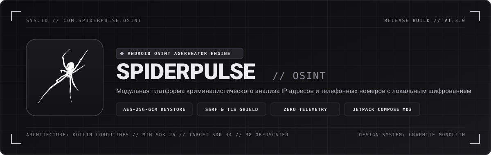
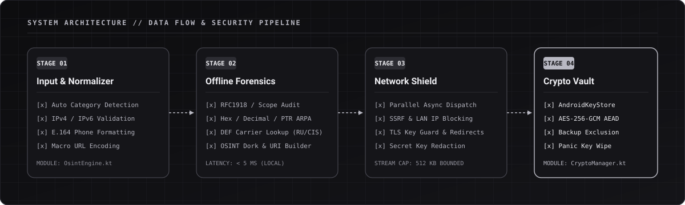
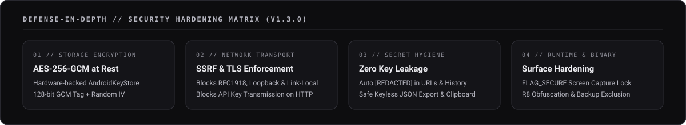

<p align="center">
  
</p>

<p align="center">
  
  
  
  
  
</p>

---

## 01 // О ПРОЕКТЕ

**SpiderPulse OSINT** — автономный модульный агрегатор открытых источников разведки (OSINT) для платформы Android, предназначенный для параллельного криминалистического анализа **IP-адресов (IPv4 / IPv6)** и **телефонных номеров (E.164)**.

Приложение объединяет встроенный офлайн-анализатор сетевых и телекоммуникационных параметров с настраиваемым пулом внешних REST/JSON API. Вся архитектура построена по принципу **Zero-Trust Local-First**: программа не использует промежуточные серверы, облачные хранилища или аналитические SDK. Все запросы выполняются напрямую с устройства пользователя, а ключи доступа и история расследований хранятся в зашифрованном контейнере под управлением аппаратного модуля `AndroidKeyStore`.

---

## 02 // АРХИТЕКТУРА И КОНВЕЙЕР ОБРАБОТКИ

<p align="center">
  
</p>

| Компонент | Пакет / Модуль | Назначение |
| :--- | :--- | :--- |
| **Криптографическое ядро** | `com.spiderpulse.osint.security.CryptoManager` | Генерация и хранение 256-битных ключей в `AndroidKeyStore`, шифрование `AES/GCM/NoPadding` (128-бит тег), маскировка секретов и SSRF-фильтрация. |
| **Защищенное хранилище** | `com.spiderpulse.osint.data.LocalStorage` | Управление криптоконтейнерами `api_modules_v2.enc` и `scan_history_v2.enc`, автоматическая миграция и криптографическое уничтожение (`Panic Wipe`). |
| **Сетевой и офлайн-движок** | `com.spiderpulse.osint.network.OsintEngine` | Нормализация целей, офлайн-анализ IP и телефонов, параллельное выполнение HTTP/HTTPS-запросов, контроль редиректов и парсинг JSON-структур. |
| **Каталог модулей** | `com.spiderpulse.osint.data.DefaultModules` | Реестр из 16 преднастроенных OSINT-интеграций для анализа сетевой инфраструктуры, уязвимостей и телефонной нумерации. |
| **Графический интерфейс** | `com.spiderpulse.osint.ui.*` | Реактивный интерфейс Jetpack Compose в дизайн-системе `Graphite Monolith` (Material Design 3) с поддержкой темной и светлой палитры. |

---

## 03 // КОНТУР БЕЗОПАСНОСТИ (RELEASE V1.3.0)

<p align="center">
  
</p>

1. **Аппаратное шифрование данных (At-Rest Encryption)**:
   Все пользовательские API-ключи, заголовки авторизации и история поиска сериализуются и шифруются алгоритмом `AES-256-GCM` перед записью во внутреннюю память. Мастер-ключ генерируется внутри аппаратного модуля безопасности (`AndroidKeyStore` TEE / StrongBox) и никогда не покидает защищенный контур ОС.
2. **Защита от SSRF и сканирования локальной сети**:
   Сетевой движок проверяет все разрешенные DNS-записи хоста API перед установкой соединения. Обращения к адресам `127.0.0.0/8`, `10.0.0.0/8`, `172.16.0.0/12`, `192.168.0.0/16`, `169.254.0.0/16`, `100.64.0.0/10`, `::1` и `fc00::/7` блокируются на уровне сокета.
3. **Принудительный TLS для секретных ключей**:
   Глобальная политика `network_security_config.xml` запрещает открытый HTTP-трафик по умолчанию (`cleartextTrafficPermitted="false"`). Если в модуле задан API-ключ или токен авторизации, попытка отправки запроса по протоколу `HTTP` или понижение протокола через редирект (`HTTPS -> HTTP`) немедленно пресекается.
4. **Автоматическая цензура секретов (`[REDACTED]`)**:
   Любые значения `apiKey` автоматически вырезаются из сохраняемых URL-адресов, логов ошибок, текстовых отчетов и карточек интерфейса. При экспорте базы модулей в JSON секретные ключи по умолчанию исключаются.
5. **Защита экрана и буфера обмена**:
   Активирован системный флаг `WindowManager.LayoutParams.FLAG_SECURE`, предотвращающий создание скриншотов, видеозапись экрана и перехват изображения в меню многозадачности Android. Для Android 13+ (API 33+) используется дескриптор `ClipDescription.EXTRA_IS_SENSITIVE`.
6. **Экстренное уничтожение данных (`Panic Wipe`)**:
   Встроенный механизм криптографического сброса перезаписывает файлы хранилища случайными байтами (`SecureRandom`), удаляет их с файловой системы и уничтожает мастер-ключ в `AndroidKeyStore`.

---

## 04 // БАЗА МОДУЛЕЙ И ОФЛАЙН-АНАЛИЗАТОР

### Локальный криминалистический анализатор (Offline)
Выполняется мгновенно на устройстве без выхода в сеть:
- **Для IP-адресов**: валидация IPv4/IPv6, определение типа адресации (Public, RFC1918 Private, Loopback, Link-Local, Multicast), расчет `Decimal (Integer)`, `Hexadecimal`, генерация зоны `PTR ARPA` и системный `Reverse DNS`.
- **Для телефонных номеров**: нормализация к стандарту `E.164`, определение страны по международному префиксу, декодирование российской системы нумерации `DEF / ABC` с определением базового оператора (МТС, МегаФон, Билайн, Т2 Мобайл, Yota, Т-Мобайл, Ростелеком), генерация прямых URI (`WhatsApp`, `Telegram`) и поисковых дорков.

### Преднастроенные сетевые модули (16 интеграций)

| ID модуля | Сервис | Категория | Авторизация | По умолчанию |
| :--- | :--- | :--- | :--- | :--- |
| `ip_api_com` | **IP-API.com** (Geo, ISP, ASN, Proxy/Hosting) | `IP` | `NONE` | Включен |
| `shodan_internetdb` | **Shodan InternetDB** (Открытые порты, CPE, CVE) | `IP` | `NONE` | Включен |
| `ipwho_is` | **ipwho.is** (Расширенный Whois, ASN, Валюта) | `IP` | `NONE` | Включен |
| `ipinfo_io` | **IPInfo.io** (Hostname, Геолокация, Организация) | `IP` | `QUERY_PARAM` (Опц.) | Включен |
| `ripe_stat_network` | **RIPEstat** (Префикс BGP, ASN, Abuse-контакты) | `IP` | `NONE` | Включен |
| `bgpview_ip` | **BGPView** (Маршрутизация BGP, PTR, RIR) | `IP` | `NONE` | Включен |
| `abuseipdb_check` | **AbuseIPDB v2** (Репутация IP, отчеты об атаках) | `IP` | `HEADER` (`Key`) | Выключен |
| `virustotal_ip` | **VirusTotal v3** (Threat Intelligence, 90+ движков) | `IP` | `HEADER` (`x-apikey`) | Выключен |
| `shodan_host_full` | **Shodan Host API** (Полное досье хоста и баннеры) | `IP` | `QUERY_PARAM` (`key`) | Выключен |
| `greynoise_community` | **GreyNoise Community** (Детекция сканеров и RIOT) | `IP` | `HEADER` (`key`) | Выключен |
| `ipqualityscore_ip` | **IPQualityScore** (Оценка фрода, Tor/VPN/Botnet) | `IP` | `URL_PLACEHOLDER` | Выключен |
| `htmlweb_phone_ru` | **HTMLWeb Geo Phone** (Оператор и регион РФ/СНГ) | `PHONE` | `QUERY_PARAM` (Опц.) | Включен |
| `numverify_phone` | **Numverify API** (Валидация линии и оператора) | `PHONE` | `QUERY_PARAM` (`access_key`) | Выключен |
| `veriphone_io` | **Veriphone.io** (Проверка активности и оператора) | `PHONE` | `QUERY_PARAM` (`key`) | Выключен |
| `abstractapi_phone` | **AbstractAPI Phone** (Глобальная валидация номера) | `PHONE` | `QUERY_PARAM` (`api_key`) | Выключен |
| `dadata_phone_clean` | **DaData.ru** (Стандартизация с учетом MNP, POST) | `PHONE` | `HEADER` (`Authorization`) | Выключен |

---

## 05 // КОНСТРУКТОР ПОЛЬЗОВАТЕЛЬСКИХ API И МАКРОСЫ

В разделе **База API** реализован визуальный конструктор и система пакетного JSON-импорта/экспорта, позволяющая подключать неограниченное количество собственных корпоративных или коммерческих источников данных.

### Поддерживаемые макросы подстановки

| Макрос | Область применения | Описание значения |
| :--- | :--- | :--- |
| `{target}` | URL, Заголовки, POST Body | Нормализованная цель (IP-адрес или номер в международном формате `+79991234567`). |
| `{target_clean}` | URL, Заголовки, POST Body | Очищенная строка без спецсимволов и знака плюс (`79991234567`). |
| `{api_key}` | URL, Заголовки, POST Body | Секретный ключ модуля из зашифрованного хранилища. |

### Формат JSON-схемы для пакетного импорта (`database/spiderpulse_api_database.json`)

```json
[
  {
    "id": "custom_threat_intel",
    "name": "Custom Threat Feed",
    "description": "Корпоративный шлюз проверки репутации узла",
    "category": "IP",
    "urlTemplate": "https://intel.example.org/v1/ip/{target}",
    "method": "GET",
    "authType": "BEARER",
    "authParamName": "",
    "apiKey": "",
    "headersRaw": "Accept: application/json",
    "postBodyTemplate": "",
    "timeoutMs": 10000,
    "enabled": true,
    "isBuiltIn": false
  }
]
```

---

## 06 // СБОРКА ИЗ ИСХОДНОГО КОДА

### Системные требования
- **JDK**: Java 17 (Temurin / OpenJDK 17)
- **Android SDK**: Compile SDK 34 (Android 14), Min SDK 26 (Android 8.0)
- **Система сборки**: Gradle 8.7 (включен в Gradle Wrapper)

### Команды сборки

```bash
# Клонирование репозитория
git clone https://github.com/kernelhistory/SpiderPulse.git
cd SpiderPulse

# Сборка релизного обфусцированного пакета (R8 + Resource Shrinking)
./gradlew clean assembleRelease

# Проверка статическим анализатором Android Lint
./gradlew lintRelease
```

Готовый релизный APK-файл формируется по пути:
`app/build/outputs/apk/release/app-release.apk`

---

## 07 // ПРАВОВОЕ УВЕДОМЛЕНИЕ

Программное обеспечение **SpiderPulse OSINT** создано исключительно для легального аудита сетевой инфраструктуры, диагностики информационной безопасности, проверки собственных ресурсов и образовательных исследований.

Пользователь несет полную единоличную ответственность за соблюдение применимого законодательства и условий использования подключаемых сторонних API-сервисов. Разработчики не несут ответственности за неправомерное использование программного продукта.

---

<p align="center">
  <code>SPIDERPULSE OSINT // RELEASE V1.3.0 // GRAPHITE MONOLITH EDITION</code>
</p>
