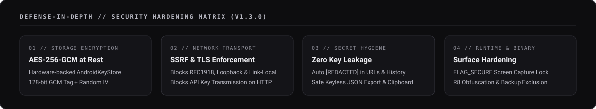

# Политика безопасности // Security Policy

  

---

## 01. Архитектура безопасности (Release v1.3.0)

SpiderPulse спроектирован по принципу **Zero-Trust Local-First**. Приложение не использует собственные прокси-серверы, облачные базы данных, сторонние аналитические SDK или системы телеметрии. Вся обработка данных и хранение ключей происходят исключительно на устройстве пользователя под защитой аппаратного криптопровайдера Android.

| Уровень защиты | Механизм реализации | Статус |
| :--- | :--- | :--- |
| **Хранение данных (At-Rest)** | Шифрование `AES-256-GCM` через аппаратный модуль `AndroidKeyStore` (128-бит тег аутентификации, случайный IV на каждую запись). | Активно |
| **Защита сетевого транспорта** | Глобальный запрет `cleartextTrafficPermitted="false"` в `network_security_config.xml`. Блокировка отправки API-ключей по протоколу HTTP. | Активно |
| **Защита от SSRF и LAN-атак** | Фильтрация DNS-резолвинга и блокировка запросов к `127.0.0.0/8`, `10.0.0.0/8`, `172.16.0.0/12`, `192.168.0.0/16`, `169.254.0.0/16`, `100.64.0.0/10` и `fc00::/7`. | Активно |
| **Контроль HTTP-редиректов** | Отключение автоматических редиректов (`instanceFollowRedirects = false`). Ручная верификация каждого перехода с защитой от понижения `HTTPS -> HTTP` и утечки заголовков авторизации на сторонние домены. | Активно |
| **Защита от утечки ключей** | Автоматическая маскировка (`[REDACTED]`) секретных токенов в URL-адресах, отчетах, логах ошибок и истории сканирований. | Активно |
| **Защита экрана и буфера** | Флаг `WindowManager.LayoutParams.FLAG_SECURE` (блокировка скриншотов, записи экрана и превью в меню многозадачности) + флаг `EXTRA_IS_SENSITIVE` для буфера обмена Android 13+. | Активно |
| **Изоляция резервных копий** | Полное исключение внутренних файлов из Google Cloud Backup и Device-to-Device (D2D) переноса через `data_extraction_rules.xml` и `backup_rules.xml`. | Активно |
| **Криптографический сброс** | Функция экстренной очистки (`Panic Wipe`): перезапись файлов криптоконтейнеров криптостойкими случайными байтами (`SecureRandom`), удаление файлов и ротация мастер-ключа в `AndroidKeyStore`. | Активно |
| **Защита бинарного кода** | Агрессивная обфускация и оптимизация байткода через R8 (`isMinifyEnabled = true`, `isShrinkResources = true`) с удалением отладочных вызовов `android.util.Log`. | Активно |

---

## 02. Поддерживаемые версии

Обновления безопасности выпускаются для актуальной ветки релизов:

| Версия | Статус поддержки | Примечание |
| :--- | :--- | :--- |
| **1.3.x** | Поддерживается | Полное шифрование `AES-256-GCM`, SSRF-фильтр, `FLAG_SECURE`, R8 |
| **1.2.x и ниже** | Не поддерживается | Устаревший формат хранения без аппаратного шифрования |

---

## 03. Регламент сообщения об уязвимостях

Если вы обнаружили уязвимость в механизмах шифрования, сетевом движке или обработке пользовательских данных SpiderPulse:

1. **Не публикуйте** эксплойт или детали уязвимости в публичных GitHub Issues до выпуска патча.
2. Воспользуйтесь механизмом **GitHub Private Vulnerability Reporting** во вкладке `Security -> Report a vulnerability` данного репозитория.
3. Укажите в отчете:
   - Версию приложения и версию Android (API Level).
   - Затронутый компонент (`CryptoManager`, `OsintEngine`, `LocalStorage`, UI).
   - Пошаговый сценарий воспроизведения (Proof of Concept).
   - Оценку потенциального влияния на конфиденциальность ключей или локальных данных.

Срок первичного рассмотрения отчета составляет до 48 часов.
